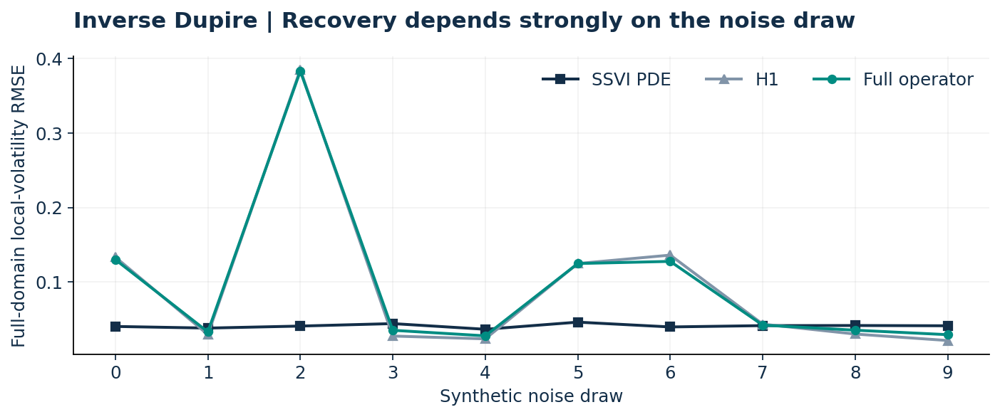

# Recovering Volatility from Option Prices

**Can a model fitted to a limited set of option prices price other options accurately—and recover the right underlying volatility?**

An option-pricing model needs to describe how volatility changes across prices and time. Market quotes only reveal part of that picture, and fitting them too closely can produce an unstable surface. This project tests whether a location-dependent penalty makes that reconstruction more reliable.

I built the pricing solver, calibration pipeline and controlled comparisons. The result is **mixed**: the proposed penalty improves some unseen option-price predictions, but can perform worse on entire unseen expiries and is unstable when tested against a known volatility surface. Better pricing on one test does not guarantee better recovery of the hidden surface.

[**Results and interpretation**](docs/RESULTS.md) · [**Full research report**](Dupire_Literature_Audit_Report.pdf) · [**Theory and assumptions**](reports/Regularizer_Theory.md)

## What I built

- A numerical solver for the **Dupire option-pricing PDE** and an optimisation routine that fits a positive local-volatility surface to option prices.
- A penalty combining smoothness with location-dependent terms, motivated by an operator formulation.
- A common comparison framework for the proposed penalty, a parametric volatility baseline (**SSVI**), simpler smoothness penalties and an unpenalised correction.
- Tests using both unseen individual quotes and entirely unseen expiry dates, plus synthetic data whose true volatility is known.

## Results in context

These are pricing-error comparisons with the SSVI-based pricing baseline. A smaller RMSE means predicted option prices are closer to the withheld prices.

| Data | What was withheld | Proposed method's pricing error versus baseline |
|---|---|---:|
| Euro Stoxx market options | Individual quotes | **34.18% lower** |
| Euro Stoxx market options | Entire expiries | **46.81% higher** |
| Author-supplied simulated Bates prices | Individual quotes | **75.30% lower** |
| Author-supplied simulated Bates prices | Entire expiries | **75.44% lower** |

Across ten new noise draws with known underlying volatility, the proposed method won five times but had **higher mean recovery error** than SSVI: 0.09679 versus 0.04096. Some unstable fits dominate that average. The full study covers **50 outer folds** and reports comparisons with both simpler penalties as well. [All tables and failure modes](docs/RESULTS.md).



## How the method works

The calibration starts from an SSVI reference surface and fits a tapered correction to its log variance. The penalty discourages excessive size, roughness and certain location-dependent behaviour in that correction. Holding the reference, numerical solver, weights and optimisation budget fixed makes it possible to test whether changing the penalty helps.

In technical notation:

$$\min_h\;\|W(F(u_{\mathrm{ref}}+h)-C_{\mathrm{obs}})\|_2^2+\lambda h^\top Rh,\qquad\sigma_{\mathrm{loc}}^2=\exp(u).$$

Here the pricing map is $F$, the fitted correction is $h$, and $R$ defines the penalty. [The derivation](reports/Regularizer_Theory.md) explains the grid scaling and bias–variance trade-off; [the literature comparison](reports/Literature_Comparison.md) distinguishes this implementation from the source papers.

## Limits of the conclusion

The comparisons use finite optimisation budgets, and many fits reached iteration limits. Market data provide no true local-volatility surface. Quote weights are declared numerical weights rather than measured bid–ask uncertainty. The simpler penalties share this project's parameterisation and are not exact reproductions of every paper's software. The study evaluates calibration and pricing, not trading profitability or universal superiority.

## Reproduce and inspect

Saved result tables and figures are browsable immediately. Python 3.12.14 was used for the audit. From the repository root:

```bash
python -m pip install -r requirements-audit.txt
python -m pytest -q
OPENBLAS_NUM_THREADS=1 python scripts/23_literature_benchmarks.py --inputs data/literature/benchmark_inputs --jobs 6
OPENBLAS_NUM_THREADS=1 python scripts/24_literature_diagnostics.py --stage outputs/stage_23_literature_audit_final --jobs 3
OPENBLAS_NUM_THREADS=1 python scripts/25_parameter_grid_sensitivity.py
OPENBLAS_NUM_THREADS=1 python scripts/26_analyze_literature_results.py
```

The full benchmark is computationally expensive. [Input provenance](data/literature/benchmark_inputs/README.md), [pricing code](src/pricing/), [calibration code](src/inverse/) and [penalty code](src/regularization/) provide the implementation detail.

For archived arrays, extract `calibration-arrays.zip` at the repository root with `python -m zipfile -e calibration-arrays.zip .`; [ARTIFACTS.json](ARTIFACTS.json) lists paths and hashes. Earlier notebooks and outputs remain historical evidence, separate from the current audit. The archived Laplace module is outside the current study.

**Author:** Fakhruddin Hakim Hussain · [Portfolio](https://github.com/Fakhruddin12)
