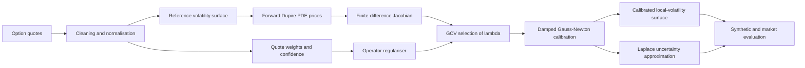

# Operator-Regularized Inverse Dupire Calibration

> **Latest audit: 23 October 2026.** The current code includes positive SSVI ATM extrapolation, corrected regularization quadrature, and a fixed-grid pricing/sensitivity engine for controlled literature benchmarks. See `reports/Dupire_Literature_Audit_Report.pdf` and `outputs/stage_23_literature_audit_final/`. Earlier Stage 10-22 tables below are historical outputs, retained for traceability; they were not regenerated after these fixes and are not the current implementation's benchmark results. The historical Laplace module is outside this audit's scope.

## Completed audit outcome

All 50 outer folds, 50 numerical-diagnostic folds and three correction-grid sensitivity refits are complete. All 61 tests pass. The proposed full operator does not show a consistent advantage over conventional H1/H2 regularization: it improves several pricing comparisons, but loses others. Known-truth recovery is unstable: full-region mean local-volatility RMSE is 0.09679 versus 0.04096 for SSVI, and the full operator wins only five of ten noise draws. The report includes every outcome, ablations and mathematical assumptions.

These are finite-budget comparisons. Seventy-two selected correction fits reached the Gauss-Newton limit; only three subsequent refinements returned optimizer-success flags. The benchmark does not establish a comparison between proven global minimizers or a claim of novelty.

## Reproduce the literature audit

Use Python 3.12.14 and the pinned audit dependencies.

```bash
python -m pip install -r requirements-audit.txt
python -m pytest -q
OPENBLAS_NUM_THREADS=1 python scripts/23_literature_benchmarks.py --inputs data/literature/benchmark_inputs --jobs 6
OPENBLAS_NUM_THREADS=1 python scripts/24_literature_diagnostics.py --stage outputs/stage_23_literature_audit_final --jobs 3
OPENBLAS_NUM_THREADS=1 python scripts/25_parameter_grid_sensitivity.py
OPENBLAS_NUM_THREADS=1 python scripts/26_analyze_literature_results.py
OPENBLAS_NUM_THREADS=1 python scripts/27_write_audit_report.py
```

The comparisons hold the SSVI reference, log-variance correction coordinates, taper, numerical solver, weighting and optimization procedure fixed while changing the penalty. H1 and H2 are controlled conventional comparators in the same coordinates, not byte-for-byte reproductions of the papers' original implementations. The author's neural-network model is not reimplemented. Market inputs provide no bid-ask spread; scaling is a declared vega-based numerical weighting, not an estimated market noise variance. The Albani experiment uses its published truth and quote layout with fresh random draws and a known spot; it does not reproduce the paper's spot-adjustment exercise.

The new SSVI price fit is conservatively restricted to global sufficient butterfly conditions. All compared correction methods share this reference. A lower test error than this SSVI baseline does not establish superiority over every SSVI calibration method.

The final pricing comparisons use `final_metrics.csv` with `evaluation=refined_price`, after all numerical diagnostics finish. `pooled_metrics.csv` contains the original coarse-grid estimates and is not the final evidence table. Original, training-only-polished, refined-grid and widened-domain predictions are retained separately in `final_predictions.csv`.

`reports/Regularizer_Theory.md` derives the exact risk of the fixed linearized estimator, a scalar counterexample to universal improvement, a conditional Bayesian optimality statement, and the distinction between numerical stability and estimation accuracy. These statements do not require market data; their assumptions do not constitute an unconditional guarantee for the nonlinear fitted estimator.


A reproducible Python implementation of a **deterministic-plus-Laplace pipeline** for recovering a local-volatility surface from option prices, with synthetic recovery tests and a carefully bounded SPX calibration study.

The project treats local-volatility calibration as an ill-posed inverse problem. It combines a forward Dupire PDE solver, log-variance parameterisation, weighted nonlinear calibration, a Schrödinger-type regulariser, generalised cross-validation (GCV), and a Laplace approximation for uncertainty quantification.

## Project highlights

- Finite-difference pricing under a two-dimensional local-volatility surface
- Raw and smoothed direct-Dupire baselines
- Stable calibration in log-variance, ensuring positive local variance
- Spatial and maturity regularisation with natural discrete Neumann boundaries
- Wing- and quote-confidence-dependent potential penalties
- Linearised and nonlinear damped Gauss–Newton inverse solvers
- Automatic regularisation-strength selection using GCV
- Laplace uncertainty bands around the calibrated surface and prices
- Synthetic recovery benchmarks, repeated-noise experiments, and an SPX case study
- A full-domain SSVI local-volatility prior with a compact operator-regularized residual correction
- **61 automated tests** covering the core numerical pipeline

## Why regularisation is needed

Dupire inversion requires derivatives of an option-price surface. Market quotes are sparse and noisy, so direct differentiation amplifies small errors and can create unstable, negative, or undefined local variances.

This project instead parameterises the local variance as

\[
u(x,T)=\log \sigma_{\mathrm{loc}}^2(x,T),
\qquad
\sigma_{\mathrm{loc}}^2(x,T)=e^{u(x,T)},
\]

and calibrates it through the nonlinear PDE pricing map \(F(u)\):

\[
\min_u
\left\|W\bigl(F(u)-C^{\mathrm{obs}}\bigr)\right\|_2^2
+
\lambda (u-u_{\mathrm{ref}})^\top R(u-u_{\mathrm{ref}}).
\]

Here:

- \(W\) contains quote weights;
- \(u_{\mathrm{ref}}\) is a fixed reference log-variance surface;
- \(\lambda\) controls the fit-versus-stability trade-off;
- \(R\) is the operator regulariser

\[
R=
\beta I
+\alpha_x D_x^\top D_x
+\alpha_T D_T^\top D_T
+\operatorname{diag}(V).
\]

The difference terms penalise roughness across log-moneyness and maturity. The potential \(V\) penalises unsupported corrections more strongly in sparse regions and in the wings. The first-difference construction leaves boundary values free and gives the natural discrete analogue of Neumann boundary conditions.

The synthetic pipeline selects its regularisation parameter by minimising a GCV score over a candidate grid. The final SPX residual-correction experiment instead selects its λ by nonlinear PDE repricing on an inner validation split, then refits on the complete outer training sample.

## Pipeline



## Main results

### Final realistic-bumpy synthetic benchmark

The final benchmark uses 136 noisy option quotes and a local-volatility surface containing both a localised positive feature and a secondary dip.

| Method | Local-volatility RMSE | MAE | Valid fraction |
|---|---:|---:|---:|
| **Operator-regularised** | **0.00571** | **0.00447** | **1.000** |
| SSVI + Dupire | 0.01195 | 0.00723 | 1.000 |
| Smoothed direct Dupire | 0.03683 | 0.01513 | 0.926 |
| Raw direct Dupire | 0.06163 | 0.02754 | 0.897 |

The operator estimate achieved a feature correlation of **0.910** with the true surface. GCV selected \(\lambda=1000\), and the nonlinear calibration stopped by relative-objective tolerance.

Across ten repeated-noise experiments, the computationally cheaper linearised operator recalibration won all ten comparisons against SSVI:

| Method | Mean RMSE | RMSE standard deviation |
|---|---:|---:|
| **Operator-regularised, linearised** | **0.00759** | **0.00101** |
| SSVI + Dupire | 0.01281 | 0.00141 |
| Smoothed direct Dupire | 0.03595 | 0.02204 |
| Raw direct Dupire | 0.04634 | 0.01464 |

### SPX market case study

The first operator fit used a constant-volatility reference and flat-clipped the local-volatility grid outside the quoted domain. Continuing that fit beyond its original three Gauss–Newton steps converged but did not close the gap to SSVI. A subsequent diagnostic showed why the surface design needed improvement: a forward PDE requires local volatility at short maturities and in the wings, even when no quotes are observed there.

The final candidate uses a training-only SSVI fit to define the full-domain prior and learns a smooth, tapered correction in log variance:

\[
\sigma_{\mathrm{loc}}(x,T)=\sigma_{\mathrm{SSVI,loc}}(x,T)
\exp\!\left(\tfrac12 q_x(x)q_T(T)h(x,T)\right),
\qquad
\min_h \;\|W(F(h)-C^{\mathrm{obs}})\|_2^2+\lambda h^\top R h.
\]

The quote panel has 840 outer training and 203 outer test quotes from one SPX valuation date. The quote-level holdout interleaves log-moneyness within expiry, so nearby strikes can appear in both sets; this measures same-surface interpolation/repricing, not independence across dates. The inner tuning split uses 673 fit and 167 validation quotes; the chosen value is \(\lambda=1000\). The local-volatility correction is supported on a broader \((x,T)\) domain than the quotes, tapers to zero at its boundaries, and leaves the SSVI prior to supply short-time and wing behavior.

| Method | Split | Price RMSE | Weighted price RMSE | IV RMSE | Inside bid–ask |
|---|---|---:|---:|---:|---:|
| SSVI–Dupire | Train | 1.1889 | 5.3072 | 0.004460 | 28.21% |
| Constant-reference operator | Train | 3.1105 | 8.7360 | 0.007074 | 18.93% |
| **SSVI + operator correction** | **Train** | **0.1053** | **0.5225** | **0.001009** | **95.71%** |
| SSVI–Dupire | Test | 1.1703 | 5.2366 | 0.003709 | 26.60% |
| Constant-reference operator | Test | 3.0894 | 8.4431 | 0.005445 | 19.21% |
| **SSVI + operator correction** | **Test** | **0.1186** | **0.5788** | **0.000630** | **94.58%** |

On this cross-sectional holdout, the correction reduces weighted price RMSE by 88.9% relative to SSVI and has lower weighted squared error on all eight expiry groups. An expiry-cluster bootstrap gives a descriptive 95% interval of [13.15, 43.55] for the mean paired reduction in weighted squared error. There are only eight expiry groups on one date, so this interval is not evidence of time-series robustness, future market performance, or trading alpha. The result supports a narrower claim: a smooth Dupire correction can materially improve same-surface quote repricing over the fitted SSVI prior in this one data snapshot.

The PDE implementation was separately checked against direct SSVI pricing. With the continuous SSVI local-volatility callback on \([-1,1]\), PDE price RMSE against the direct formula falls from 0.111 on a 201-by-300 grid to 0.028 on a 401-by-1,200 grid. This is a numerical consistency check, not a market-performance result.

### Leave-one-expiry-out diagnostic

To test maturity transfer rather than strike interpolation, we reran the fit eight times, holding out every quote at one expiry per fold. Both the SSVI surface and operator correction were fitted only on the other seven expiries. The correction used the Stage 18 nonlinear Gauss–Newton refinement; the regularization value \(\lambda=1000\) was frozen from earlier validation.

| Model | Pooled price RMSE | Weighted price RMSE | IV RMSE | Inside bid–ask |
|---|---:|---:|---:|---:|
| SSVI–Dupire, PDE matched | **1.402** | **6.089** | 0.004341 | **17.35%** |
| SSVI + nonlinear operator correction | 2.850 | 8.137 | **0.003756** | 9.11% |

The correction won on weighted price RMSE in only **3 of 8 expiry folds**. It therefore did not transfer reliably to expiries omitted from calibration on this date, despite the strong interleaved quote-holdout result. The IV metric favors the correction while price-weighted error and bid–ask containment favor SSVI; do not summarize this as a general improvement. Since \(\lambda\) came from earlier validation on this same panel, the grouped diagnostic is not a fully untouched nested test. It is one valuation date and says nothing about performance across dates or regimes.

Run `python scripts/21_expiry_holdout_cv.py --nonlinear-iterations 4` followed by `python scripts/22_expiry_holdout_pde_baseline.py` to reproduce the diagnostic.

## Repository structure

```text
.
├── data/
│   ├── market/                 # Required licensed market inputs are not bundled
│   └── synthetic/              # Synthetic benchmark quote sets
├── notebooks/                  # Fourteen sequential research notebooks
├── outputs/                    # Validated numerical results and checkpoints
├── scripts/                    # Data, benchmark, calibration and diagnostics jobs
├── src/
│   ├── bayesian/               # Laplace approximation
│   ├── data/                   # Synthetic and market-data preparation
│   ├── dupire/                 # Direct Dupire estimators
│   ├── evaluation/             # Benchmarks, SSVI and diagnostics
│   ├── inverse/                # Linearised and nonlinear calibration
│   ├── pricing/                # Black-Scholes and PDE pricing
│   ├── regularization/         # Operators, potentials and scaling
│   └── surfaces/               # Grids, smoothing and synthetic surfaces
├── tests/                      # Automated test suite
├── requirements.txt
└── README.md
```

## Notebook roadmap

| Stage | Notebook | Purpose |
|---:|---|---|
| 1 | `01_black_scholes_and_grids.ipynb` | Black-Scholes utilities and numerical grids |
| 2 | `02_local_vol_pde_pricer.ipynb` | Forward local-volatility PDE solver |
| 3 | `03_synthetic_data.ipynb` | Controlled synthetic option quotes |
| 4 | `04_dupire_baselines.ipynb` | Raw and smoothed direct-Dupire baselines |
| 5 | `05_regularization_operators.ipynb` | Difference operators, potentials and boundary treatment |
| 6 | `06_linearized_inverse.ipynb` | Weighted linearised inverse problem |
| 7 | `07_nonlinear_gauss_newton.ipynb` | Damped nonlinear calibration |
| 8 | `08_tuning_and_diagnostics.ipynb` | Scaling, GCV, ablations and residual diagnostics |
| 9 | `09_laplace_uncertainty.ipynb` | Surface and predictive uncertainty |
| 10 | `10_synthetic_benchmark.ipynb` | Smooth synthetic comparison |
| 11 | `11_localized_bump_stress_test.ipynb` | Localised-feature recovery stress test |
| 12 | `12_real_option_data_preparation.ipynb` | Offline SPX data preparation |
| 13 | `13_real_market_model_comparison.ipynb` | Held-out operator-versus-SSVI comparison |
| 14 | `14_realistic_bumpy_benchmark.ipynb` | Final repeated-noise benchmark |

## Installation

Clone the repository and create a clean environment:

```bash
git clone https://github.com/Fakhruddin12/operator-regularized-dupire.git
cd operator-regularized-dupire

conda create -n dupire_env python=3.12 -y
conda activate dupire_env
pip install -r requirements.txt
```

## Validation

Run the complete test suite from the project root:

```bash
python -m pytest tests -q
```

Current expected result:

```text
60 passed
```

Launch the notebooks with:

```bash
jupyter lab
```

Run the notebooks in numerical order. Several notebooks include validated stored outputs, so the results can be inspected without repeating every expensive calibration.

## Long-running scripts

The longer market and final-benchmark calculations are also available as standalone scripts:

```bash
python scripts/13a_tune_real_market.py --project-root .
python scripts/13b_fit_compare_real_market.py --project-root .
python scripts/14_run_realistic_bumpy_benchmark.py --project-root . --mode full
python scripts/15_market_solver_convergence.py --maximum-iterations 12
python scripts/17_pde_discretization_sensitivity.py
python scripts/18_ssvi_prior_full_domain_correction.py
python scripts/18a_finalize_full_domain_correction.py
python scripts/19_expiry_cluster_diagnostics.py
python scripts/20_ssvi_pde_consistency.py
python scripts/21_expiry_holdout_cv.py --nonlinear-iterations 4
python scripts/22_expiry_holdout_pde_baseline.py
```

Use `--mode quick` for a reduced Stage 14 diagnostic run. Add `--overwrite` only when intentionally replacing existing Stage 14 results.

## Surface convention

All surfaces have shape

```text
(number of maturities, number of log-moneyness points)
```

Rows correspond to maturities and columns to log-moneyness. Arrays are flattened in C order, so log-moneyness varies fastest.

## Scope and limitations

- Synthetic truth is known only for project-designed surfaces; those results do not guarantee market performance.
- The initial market study uses one SPX snapshot and a quote-level cross-sectional holdout, not a chronological test; nearby strikes can occur on both sides of that split. A separate leave-one-expiry-out diagnostic is also included and shows weaker maturity transfer for the operator correction. The Cboe raw and prepared market input files are not included in this working-tree package; reproduce that case only if you have the licensed/source snapshot and follow the preparation instructions in Notebook 12.
- The SSVI-centred residual model's strong quote-fit result must be retested across independent dates before claiming stability or market-wide superiority.
- Quote repricing is not a trading strategy, hedging result, or evidence of positive P&L.
- The recovered market local-volatility surface is not certified static-arbitrage-free.
- The Jacobian is constructed by finite differences, which is transparent but computationally expensive.
- The Laplace approximation is local and approximately Gaussian around the calibrated solution.
- This repository is a research and educational implementation, not a production trading or risk system.

## Author

**Fakhruddin Hussain**  
MSc Statistics with Data Science, University of Edinburgh  
Quantitative research portfolio project

## References

- Dupire, B. (1994). *Pricing with a Smile*. Risk.
- Gatheral, J. and Jacquier, A. (2014). *Arbitrage-free SVI volatility surfaces*. Quantitative Finance.
